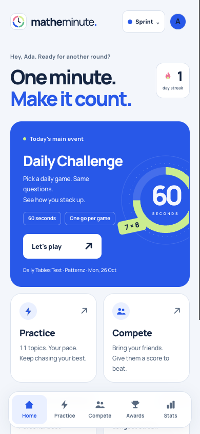
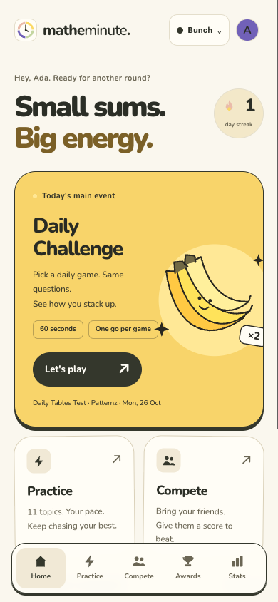
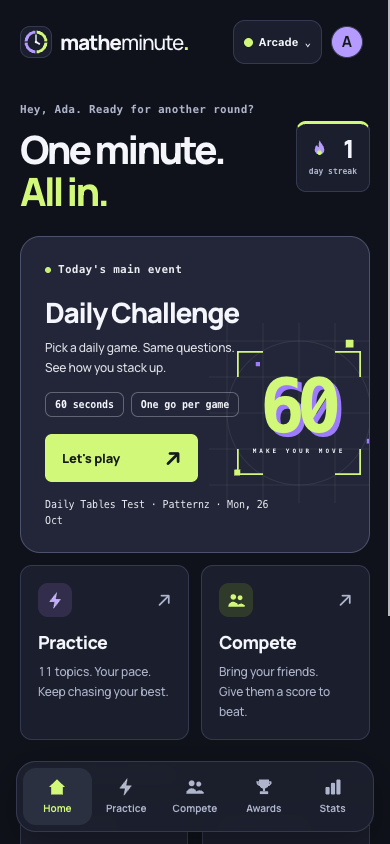

# MatheMinute design and UX review

Reviewed 26 October 2026 against the working app, including the Daily Tables Test and Patternz. This is a product and interaction review, with three working visual directions. It is not a security audit or a measured usability study.

## Adopted design

Arcade is now the normal interface on `main`, with its shared layout, typography, compact header and five navigation destinations. Dark mode retains ink, lime and lilac. Light mode uses Sprint's blue with fluorescent orange replacing green, on pale surfaces. Settings → Colours retains Light, Dark and Same as device. The design preview switcher, cookie handling and conditional view layer have been removed.

Open the normal app at http://localhost:3200/ (or your existing Rails server). New visitors still choose a topic first. The saved colour preference carries through navigation, games and browser theme colours; Same as device follows device changes automatically.

The screenshots below document the original three directions, before this selection. They are retained as design history; the old `?design=` links no longer select a design.

## Original recommendation

Make the app feel like a small, confident game: one clear daily event, a fast way to practise, and visible competition. Keep the one-minute format, straightforward input, personal bests and small-group rivalries. Avoid introducing a course dashboard, a curriculum map or a reward-management game.

Sprint originally offered the clearest sporting direction, Bunch explored a banana identity, and Arcade offered a stronger competitive identity. The adopted design combines Arcade's structure with separate light and dark palettes. The name, currencies and gameplay rules remain unchanged.

## What already works

- A one-minute round is an unusually clear commitment. Preserve its countdown, immediate answer feedback and clean finish.
- Guest play keeps registration out of the way. Keep account creation secondary until a player has progress to save.
- The clock symbol has a real relationship to the game. Retaining it gives a redesign continuity.
- Best scores, ghosts, rematches and private groups give competition a human scale.
- Practice, untimed review and tiny worked examples can support the next game without becoming a learning platform.
- Reduced-motion handling, labelled controls, keyboard input and large keypad buttons are good foundations.

## Findings and proposed changes

Priority means impact on the quick-play experience, rather than a software severity rating.

| Priority | Finding | Design response | Status |
| --- | --- | --- | --- |
| High | The home screen's three similar buttons do little to explain why today's game is special. | Give Daily Challenge one event card, a duration, a clear action and a visible completed state. Keep Practice and Compete easy to reach. | Implemented in all three previews. |
| High | The large wordmark and greeting use valuable phone space; the desktop version is essentially a narrow phone screen in a wide empty page. | Use a compact header, a purposeful headline and responsive card layouts. Keep the streak visible as a small status rather than the main objective. | Implemented. |
| High | Practice and competition are important destinations but are absent from the permanent navigation. | Use Home, Practice, Compete, Awards and Stats consistently. Put settings in the header and show the active destination. | Implemented in the previews. |
| High | First-time visitors must evaluate eleven topics before experiencing a game. | Test a recommended first round with a secondary topic chooser; retain a way to select a topic immediately. Make the first game possible without understanding levels or rewards. | Proposed next; onboarding behaviour is preserved. |
| High | Results can put a tutorial, detailed score breakdown and newly earned awards ahead of the replay or next action. | Put score, best/standing and Play again/See leaderboard together at the top. Keep the explanation and awards below. A celebration should not make the next minute harder to reach. | Proposed next; the preview changes result styling, not action order. |
| High | A points score, number correct, speed bonuses and combos can be difficult to distinguish at a glance. | Use explicit labels such as Points and Right, explain the scoring in a short pre-game line and offer the detailed breakdown after play. Use the same visual order in daily, practice and live modes. | Existing rules preserved; copy and hierarchy changes proposed. |
| Medium | The competition page's empty sections say little about what a new player can actually do. | Explain each mode in one line: send a score for a friend to beat, race together now, or join a recurring group. Empty states should lead to one concrete action. | Card treatment implemented; explanatory empty states proposed. |
| Medium | The daily experience needs a clear before/after distinction, especially when there are two daily games. | Show which game remains, retain a completed result and offer a clear path to practice once finished. Reserve the daily visual accent for this event. | Home completion summary and daily-card styling implemented; existing result rules retained. |
| Medium | Levels mix stars, locks, small personal bests and instructions in a tight area. | Enclose them in one coherent control, make the selected level obvious and keep the level name readable. A later pass should test whether all of the small per-level numbers are needed simultaneously. | Visual grouping implemented; information reduction proposed. |
| Medium | Four bright colours compete across buttons, navigation, stats and icons. | Give each direction one primary accent, quieter surfaces and consistent status colours. Keep bright celebration colours for meaningful events. | Implemented, including monochrome navigation icons. |
| Medium | Dense stats can look like a school report rather than feedback for the next game. | Lead with a personal best and one useful next target. Keep detailed topic tables available behind Stats. | Home scoreboard implemented; automatic next-target copy proposed. |
| Medium | Smaller supporting text and colour-only states can be hard for younger players. | Maintain generous targets, readable secondary text, visible focus, textual status and reduced-motion support. Keep correct-answer and award labels readable in every palette. | Applied to previews; a full accessibility audit remains separate work. |
| Lower | The install prompt can compete with the game too early. | Offer installation after a successful game or return visit, and keep dismissal persistent. | Proposed; installation logic is unchanged. |

## The three directions

### Sprint

The safest primary direction: a sporting event card, blue primary action, small lime highlights and compact personal scoreboard. Desktop uses the available space instead of stretching a single column. Mobile keeps the daily event and two alternatives in one scan.

Use this if the audience spans primary and early secondary pupils. Its risk is looking too generic; the clock, distinctive daily artwork and satisfying game feedback need to remain recognisable.

[Sprint desktop screenshot](design-review/sprint-desktop.png)

### Bunch

A more characterful primary-school direction. Warm backgrounds, substantial rounded cards and a simple banana illustration make it friendly without needing a cartoon world or a separate collection screen. The full-width event card and slightly offset secondary cards distinguish its layout from Sprint.

Test this with older primary pupils as well as younger children. The key question is whether it feels playfully competitive or too young. The name stays MatheMinute so the visual direction can be judged independently from rebranding.

[Bunch desktop screenshot](design-review/bunch-desktop.png)

### Arcade

A more competitive direction with dark surfaces, lime action colour, lilac detail and restrained scoreboard typography. The main controls remain calm and legible; the energy is in the event artwork and reward moments.

Its risk is visual noise. Keep grids and decorative shapes away from questions and answers, avoid persistent glow, and retain the user's reduced-motion preference. Test it in both bright rooms and evening use before choosing it as the only appearance.

[Arcade desktop screenshot](design-review/arcade-desktop.png)

## Flow recommendations after selecting a direction

1. **First visit:** one recommended game, guest play, then a result worth keeping. Offer the larger topic catalogue as a choice rather than a prerequisite.
2. **Returning solo player:** show the day's unfinished challenge, a personal target and a direct Practice action. A completed daily event should feel finished.
3. **Practice:** topic, selected level, target, play. Keep reviews and worked examples relevant to getting back into a game.
4. **Competition:** choose asynchronous rivalry, live play or a group. Explain those distinctions before asking someone to create a lobby or obtain a code.
5. **During play:** keep the question, answer, timer and clearly labelled score readable. Theme controls, account prompts and navigation do not belong here.
6. **After play:** score and outcome first, then the next action. Detailed stats and awards should reward attention without requiring it.

## Validation and remaining decisions

Automated appearance checks now cover the default interface without preview parameters, all three saved colour preferences, browser theme colours and ignoring old preview links. Chrome checks cover light and dark mode at 390px and 1440px, actual settings persistence, device scheme changes, playing an answer, stopping a game and fitting fraction, function and simultaneous-equation keypads at 320px. Settings, a populated group, its leaderboard and a live lobby are also checked at 320px.

Screenshots use isolated test accounts and their actual generated attempts. They are illustrations of the interface, not production community statistics. The previews do not invent a par, player count, wallet or rivalry.

To validate the adopted design, watch a few pupils complete four tasks: start today's game, change a practice level, find a rematch and replay after a result. Compare time to action, wrong turns and whether they can explain their score. Include a returning player and a new guest. Those observations should decide the final hierarchy and branding more than a preference poll about colours.

Recommended follow-up order: bring the result action above the award feed, clarify points versus correct answers, simplify first-game entry, then improve competition empty states. Preserve the one-minute loop throughout.
